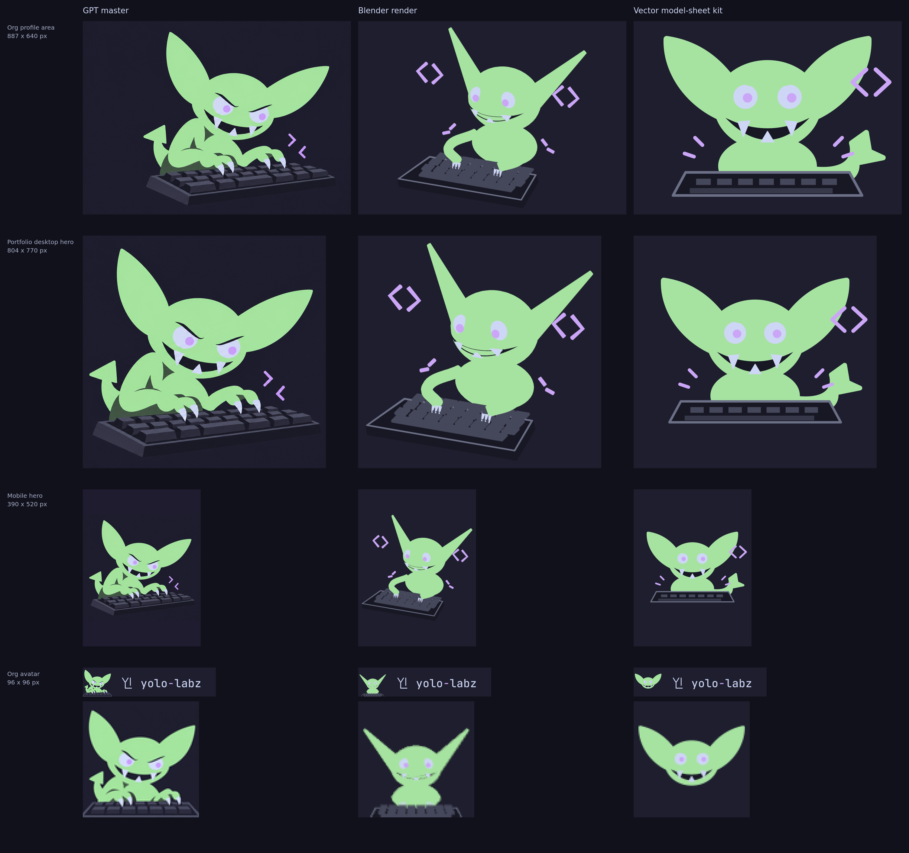

# Hero decision sheet

## Decision — 08/11/2026: the split is adopted

**Approved by the loop lead on Pedro's delegation (08/11/2026)**, adopting the recommendation below
unchanged:

- **Hero, any slot ≥ 390 px** (org profile, portfolio desktop and phone): the **GPT master**, served
  as WebP/AVIF crops — never the 1.05 MB PNG.
- **Avatar, 96 px** (the org avatar beside the `yolo-labz` wordmark): the **vector model-sheet kit**,
  `mascot/gremlin-avatar.svg`.
- **Blender is out of the served slots** until the model carries the GPT character (brows, jagged
  grin, claws, tail). It stays the source of the share cards, which this decision does not touch.

This sheet records the comparison the decision was made on; the served files are published
separately with their own provenance.

---

The text below is the sheet as it was put to the decision (02/11/2026). It puts the three candidates
side by side at the sizes the hero is actually shown, so the choice is a five-second comparison.



*Rows: org profile area 887×640, portfolio desktop hero 804×770, mobile 390×520, org avatar 96×96
(shown 1:1 next to the `yolo-labz` wordmark, then again at 4× nearest-neighbour). Every cell is at
native slot pixels on the Catppuccin Mocha plate `#1e1e2e`; nothing is mocked up.*

## Recommendation: a split decision

| Slot | Pick | Why |
|---|---|---|
| Hero, ≥ 400 px (org 887, portfolio 804, mobile 390) | **GPT master** | Only candidate that carries the identity: slanted brows, jagged fang grin, clawed hands on the keys, curled tail. Blender is the right *engine* but not yet the right *character* (calmer face, spike ears, tiny claws and no visible tail in the published pose). |
| Avatar, 96 px | **Vector model-sheet kit** (`mascot/gremlin-avatar.svg`) | Bold silhouette, flat brand palette, 811 B as AVIF; the only 96 px cell that reads as a mark beside the YL wordmark. |

Where GPT wins: expression/identity at every size ≥ 390 px, and the 804×770 cell is the best
single image on the sheet. Where GPT loses: (1) its master is 2:1 with only ~43 px of vertical
room, so the 3:4 mobile cell has to be plate-padded (character 315 px tall in a 520 px cell);
(2) its skin colour is ΔE2000 0.6–0.9 from the brand `#a6e3a1`, while the Blender and vector cells
are 0.0 by construction; (3) it is not reproducible, and today's served file is a 1.05 MB PNG
(1774×887) for a 640×320 display — the WebP cell below is 23 KB at 887×640 (**−98 %**), so the weight
problem is solvable without changing the art.

Where Blender wins: exact palette, reproducible from `model/params.json`, natively rendered at any
size with a fitted camera (zero resampling, zero padding). It becomes the right answer for the hero
only once the model carries the GPT brows, jagged grin and claws; that is a model task, not a
framing task. The vector kit wins only at 96 px.

If Pedro prefers one source everywhere: **GPT for all four** is the safest (it loses only on the
96 px clutter); **Blender for all four** is the cleanest pipeline but changes the character's attitude.

## Per-cell table

Weights are WebP (q88, method 4) and AVIF (q60, speed 4), single-threaded, metadata stripped.
"Exact fit" = the cell is exactly the slot's pixel size; ⚠ marks a cell that needed padding or
letterboxing to get there; no cell is upscaled. "Ink" is the character's bounding box in px.
"Looks like" is my visual judgement from the sheet, including the 4× zoom at 96 px; it is not a measurement.

| Slot | Source | WebP | AVIF | Exact fit | Ink | Looks like (next to the YL wordmark at 96 px: same character?) |
|---|---|---|---|---|---|---|
| Org profile area 887×640 | GPT master | 23.4 KB | 11.8 KB | ✅ crop 1229×887 → ×0.72, no pad, no upscale | 633×574 | Same character as the live hero: slanted brows, jagged fang grin, clawed hands on the keys, curled tail. |
| Org profile area 887×640 | Blender render | 17.2 KB | 8.1 KB | ✅ rendered at 887×640 | 626×574 | Palette-exact but a calmer, different character: spike ears, round eyes, thin grin, tiny claws, no visible tail. |
| Org profile area 887×640 | Vector model-sheet kit | 16.2 KB | 7.7 KB | ⚠ letterboxed (3:2 art in 1.39:1 slot) | 754×533 | Head-on pose, bold and symmetrical; readable but not the typing pose. |
| Portfolio desktop hero 804×770 | GPT master | 28.8 KB | 14.3 KB | ✅ crop 926×887 → ×0.87, no pad, no upscale | 761×690 | Strongest cell: fills the near-square slot with the full pose. |
| Portfolio desktop hero 804×770 | Blender render | 20.7 KB | 9.1 KB | ✅ rendered at 804×770 | 753×691 | Fills the slot; expression and ear shape still diverge from the GPT master. |
| Portfolio desktop hero 804×770 | Vector model-sheet kit | 14.8 KB | 6.7 KB | ⚠ letterboxed (3:2 art in 1.04:1 slot) | 684×483 | Floats small in the square with wide empty margins. |
| Mobile hero 390×520 | GPT master | 11.7 KB | 6.1 KB | ⚠ plate-padded: art is 2:1 and only 887 px tall, so ×0.40 and about a third of the cell is padding | 348×315 | Pose still legible; character is only 315 px tall in a 520 px cell. |
| Mobile hero 390×520 | Blender render | 9.6 KB | 5.1 KB | ✅ rendered at 390×520 | 367×336 | Legible and larger in frame; mauve code marks survive. |
| Mobile hero 390×520 | Vector model-sheet kit | 7.2 KB | 3.6 KB | ⚠ letterboxed (3:2 art in 3:4 slot) | 332×235 | Smallest character (235 px tall); letterbox wastes the tall slot. |
| Org avatar 96×96 | GPT master | 2.5 KB | 1.7 KB | ✅ dedicated 1254² avatar master → ×0.077 | 96×87 | Reads as the angry gremlin, but ears, claws and the keyboard edge crowd a 96 px tile. |
| Org avatar 96×96 | Blender render | 1.5 KB | 1.2 KB | ✅ rendered at 96×96, head only | 88×74 | Ears and eyes read, grin collapses to a line; looks like a different, gentler goblin. |
| Org avatar 96×96 | Vector model-sheet kit | 1.3 KB | 811 B | ✅ vector tile, 96 px | 88×50 | Best 96 px read: bold ears, eyes and fangs, same flat mauve/green as the YL mark. |

At 96 px specifically — **same character as the GPT hero?** GPT avatar: yes, but crowded. Blender
head: partly (ears and eyes, not the grin). Vector kit: reads as the same species and palette, a
different attitude; it is the clearest mark.

## Files

- `contact-sheet.png` — the sheet above (2957×2704, 8-bit).
- `cells/{slot}-{source}.{webp,avif}` — all 12 cells in both formats (`org`, `portfolio`, `mobile`,
  `avatar` × `gpt`, `blender`, `svgkit`). Lossless PNG sources are regenerated by the scripts.
- `results.json` — the numbers in the table, plus SHA-256 of every source input.
- `build_sheet.py`, `render_blender.py` — reproduce all of it.

## Sources (all unmodified, from `origin/main` at `9c77ec6`)

| Candidate | Input | SHA-256 (first 16) |
|---|---|---|
| GPT master | `rollout/gremlin-wide-hero.png` (1774×887), `exploration/2026-09-28/gremlin-square-avatar.png` (1254²) | `da70db22366e8e84`, `ceb4f3cbf60b8254` |
| Blender | `model/gremlin.py` + `model/render_hero.py`, hero pose from `model/params.json` (`renders.view`), avatar = front view framed on the head objects | — |
| Vector model-sheet kit | `mascot/gremlin-hero.svg`, `mascot/gremlin-avatar.svg` | `96c9d38c17263cb3`, `6752b26a4c2c2272` |

"Model-sheet render" is read as the vector kit that the model sheet specifies; the 1080×600
`mascot/gremlin-model-sheet.png` is a multi-pose sheet and is not a hero candidate.
The GPT crops are art-directed: the window is centred on the character's measured bounding box with
the same 6 % margin per side as the Blender fit, so the comparison is framing-for-framing.

## Reproduce

```sh
mkdir -p /tmp/hds/src            # copy the inputs above from origin/main into it
blender -b --factory-startup -t 2 -P profile/assets/brand/hero-decision/render_blender.py -- \
  --model model --out /tmp/hds/blender
python3 profile/assets/brand/hero-decision/build_sheet.py \
  --src /tmp/hds/src --blender /tmp/hds/blender --model model --out /tmp/hds/out
```

Needs Blender 5.2 LTS, ImageMagick 7 with WebP/AVIF delegates, and `rsvg-convert`. Encoder bytes
can differ across ImageMagick/libheif builds; the sheet is evidence for a decision, not a pinned
build artefact like `renders/`.
